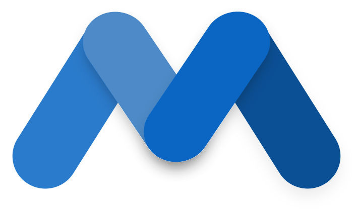

  
  <h1>Mirai</h1>
  
<strong>Tu búsqueda laboral, con un agente que trabaja a tu lado.</strong>

  
Agente de IA para descubrir oportunidades, preparar candidaturas y operar el navegador del candidato bajo su control.

  

    
    
    
  

  

    
    
    
    
  

  
<a href="https://mirai-web-4nag7kzycq-uk.a.run.app"><strong>Explorar Mirai ↗</strong></a> · <a href="docs/README.md">Documentación</a> · <a href="docs/architecture/mirai_architecture.md">Arquitectura</a> · <a href="docs/platform/mirai_ci_cd.md">CI/CD</a> · <a href="https://github.com/Paz1CP/mirai/actions">GitHub Actions</a>

---

## ✨ Qué es Mirai

Buscar empleo no consiste únicamente en encontrar una vacante. También implica contrastar requisitos, adaptar documentos, navegar portales, completar formularios y llevar un registro de los resultados.

**Mirai convierte ese trabajo repetitivo en un flujo asistido por un agente de IA.** El candidato define su objetivo, aporta información profesional y conserva el control sobre las acciones que requieren su intervención. El agente utiliza el Chrome local vinculado mediante una extensión, en lugar de un navegador alojado en la nube.

<table>
<tr>
<td width="50%" valign="top"><h3>🤖 Agente y chat</h3>Interpreta instrucciones, utiliza herramientas y comunica el progreso del trabajo.</td>
<td width="50%" valign="top"><h3>🌐 Navegador vinculado</h3>Ejecuta operaciones en Chrome mediante una extensión y un canal WebSocket.</td>
</tr>
<tr>
<td valign="top"><h3>🎯 Campañas</h3>Organiza tareas de búsqueda y postulación de varias etapas dentro del mandato del candidato.</td>
<td valign="top"><h3>📄 Biblioteca de CV</h3>Importa documentos, estructura el perfil profesional y permite preparar CV a partir de datos confirmados.</td>
</tr>
<tr>
<td valign="top"><h3>📋 Candidaturas</h3>Registra resultados y facilita el seguimiento de oportunidades y postulaciones.</td>
<td valign="top"><h3>🛡️ Control del usuario</h3>Respeta las restricciones del mandato, protege la pestaña de Mirai y solicita intervención cuando corresponde.</td>
</tr>
</table>

### 🔄 Del objetivo a la candidatura

~~~mermaid
flowchart LR
    A["Perfil y preferencias"] --> B["Mandato en chat"]
    B --> C["Agente de Mirai"]
    C --> D["Chrome vinculado"]
    D --> E["Oportunidades y formularios"]
    E --> F["Resultados y seguimiento"]
    D -. Intervención requerida .-> B
~~~

Mirai no garantiza entrevistas, ofertas ni contratación. Su alcance es el trabajo digital que realiza dentro de las instrucciones y permisos del candidato.

## 🏗️ Arquitectura

Mirai separa la interfaz, la lógica del agente y la ejecución en el navegador. Web y API se despliegan como servicios independientes; la extensión conecta el navegador de escritorio al workspace de la API.

~~~mermaid
flowchart TD
    U["Candidato / Chrome"] --> W["Web · Next.js"]
    U --> X["Extensión · WXT"]
    W --> A["API · Express"]
    W --> N["Neon Auth"]
    X <-->|WSS| A
    A --> DB[("Neon PostgreSQL")]
    A --> S["Neon Object Storage"]
    A --> AI["Vertex AI / Google ADK"]
    A --> P["Paddle"]
~~~

### 🧰 Stack tecnológico

| Capa | Tecnologías |
|---|---|
| Frontend |    |
| Backend |    |
| Agente y navegador | Google ADK · Vertex AI · MCP · WXT · Chrome Debugger API |
| Datos e identidad | Neon PostgreSQL · Drizzle ORM · Neon Auth · Object Storage (S3) |
| Infraestructura | Docker · Google Cloud Build · Artifact Registry · Cloud Run |
| Calidad y seguridad | GitHub Actions · Vitest · CodeQL · Trivy · Dependabot · OIDC/WIF |

[Consultar la arquitectura técnica →](docs/architecture/mirai_architecture.md)

## 🚀 Delivery & DevSecOps

Cada push a `main` inicia el pipeline de producción. Los contenedores se construyen desde el commit validado, se identifican por digest SHA-256 y se analizan antes de modificar el esquema de producción o el tráfico.

~~~mermaid
flowchart LR
    P["Push a main"] --> CI["CI Gate"]
    P --> Q["CodeQL"]
    CI --> B["Build API + Web"]
    B --> T["Trivy"]
    T --> M["Schema gate + migraciones"]
    Q --> M
    M --> D["Cloud Run · 0% tráfico"]
    D --> H["Health checks"]
    H --> R["Promoción + verificación"]
    R --> S["Release summary"]
    R -. Fallo .-> RB["Restaurar tráfico anterior"]
~~~

| Control | Implementación |
|---|---|
| Integración continua | Lint, typecheck, pruebas automatizadas e integración aislada en Neon dev; build de API, Web y extensión. |
| Seguridad | CodeQL con baseline de hallazgos, Trivy sobre los digests de release y actualizaciones de Dependabot. |
| Identidad cloud | GitHub OIDC + Workload Identity Federation, sin claves permanentes de despliegue. |
| Entrega | Imágenes con lockfile congelado, base fijada por digest y runtime no privilegiado. |
| Despliegue | Migraciones compatibles, revisiones candidatas sin tráfico y promoción tras verificaciones. |
| Recuperación | Rollback automático de tráfico y workflow manual de recuperación de parejas de revisiones verificadas. |

**Evidencia reproducible en GitHub Actions**

[Release de producción verificada](https://github.com/Paz1CP/mirai/actions/runs/45615408735) · [Bloqueo por migraciones](https://github.com/Paz1CP/mirai/actions/runs/45611946799) · [Rollback verificado](https://github.com/Paz1CP/mirai/actions/runs/45616829512) · [Restauración de la release](https://github.com/Paz1CP/mirai/actions/runs/45617062340)

[Guía completa de CI/CD →](docs/platform/mirai_ci_cd.md)

## 📦 Organización del repositorio

~~~text
mirai/
├── apps/
│   ├── api/           # Express, dominio, agente y workspace
│   ├── web/           # Next.js, interfaz y cliente
│   └── extension/     # WXT, conexión y control del navegador
├── packages/
│   ├── contracts/     # Contratos compartidos
│   └── cv-renderer/   # Renderizado de CV
├── ops/               # Despliegue, seguridad y recuperación
├── .github/           # Workflows y configuración de CI/CD
├── docs/              # Documentación de producto y plataforma
└── cloudbuild.yaml   # Receta de construcción de imágenes
~~~

## 💻 Desarrollo local

**Requisitos:** Git, Node.js 26, pnpm 10.33.0 y Chrome 118+ para la extensión. La ejecución completa requiere configurar servicios externos y credenciales propias de desarrollo.

~~~bash
git clone https://github.com/Paz1CP/mirai.git
cd mirai
npm install --global pnpm@10.33.0
pnpm install --frozen-lockfile
~~~

Configura los entornos de API, Web y extensión a partir de sus archivos `.env.example` siguiendo la [guía de desarrollo](docs/platform/mirai_developer_environment.md). No utilices credenciales de producción para pruebas locales.

~~~bash
pnpm dev
# En otra terminal: extensión de Chrome en desarrollo
pnpm --filter @mirai/extension dev
~~~

Comprobaciones locales (no sustituyen las integraciones contra Neon dev):

~~~bash
pnpm lint
pnpm typecheck
pnpm test:ci --coverage
python3 ops/test-release-controls.py
~~~

## 📚 Documentación

| Tema | Referencia |
|---|---|
| Producto y recorrido completo | [Workflow E2E](docs/product/mirai_workflow_e2e.md) |
| Arquitectura | [System architecture](docs/architecture/mirai_architecture.md) |
| Desarrollo local | [Developer environment](docs/platform/mirai_developer_environment.md) |
| Infraestructura | [Infrastructure & deployment](docs/platform/mirai_infrastructure_and_deployment.md) |
| Entrega y recuperación | [CI/CD & DevSecOps](docs/platform/mirai_ci_cd.md) |
| Seguridad | [Security & privacy](docs/platform/mirai_security_and_privacy.md) |

[Ver toda la documentación →](docs/README.md)

## 🎓 Propósito del proyecto

Mirai es un **proyecto personal no comercial**, desarrollado para explorar la aplicación de agentes autónomos a problemas reales y demostrar competencias de ingeniería de software de extremo a extremo: diseño de producto, arquitectura full stack, backend, integración de IA, sistemas distribuidos, seguridad, pruebas y operación cloud. Su objetivo es servir como proyecto de investigación aplicada y portfolio profesional, no como un servicio comercial en explotación. Las integraciones de pagos forman parte de la ingeniería del sistema; su presencia no constituye una oferta comercial.

El repositorio público permite examinar el código y las decisiones técnicas. La disponibilidad del código no implica una licencia de reutilización ni un compromiso de soporte.

---

  
  
<strong>Mirai</strong> · Product thinking meets software engineering.

  
Desarrollado por <a href="https://github.com/Paz1CP">Christopher Paz León</a> · <a href="https://www.christopherpaz.dev/">Portfolio</a>

