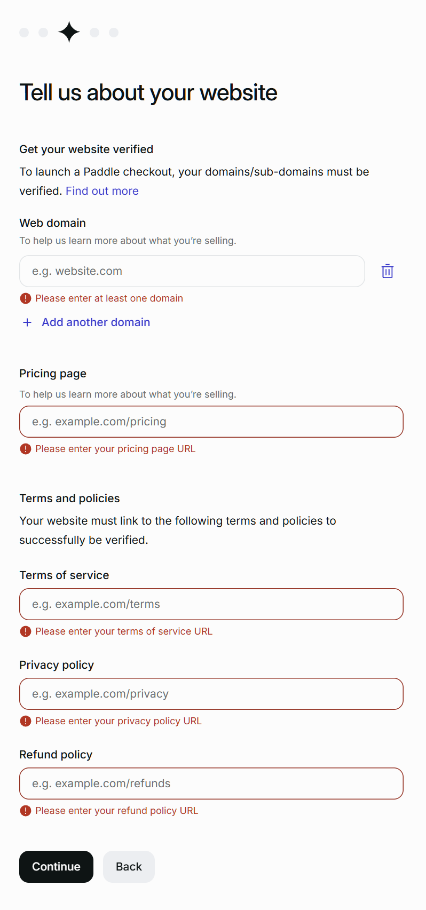

- Publicar las extensiones en chrome web store y en la tienda de Firefox. Crear un modal pidiendo la descarga de la extensión al usuario. Y mostrarla despues del login exitoso y que se haya detectado que el usuario no tiene la extensión instalada.

