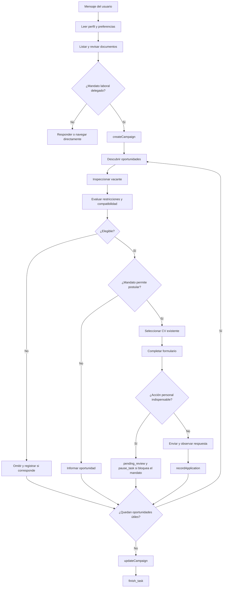
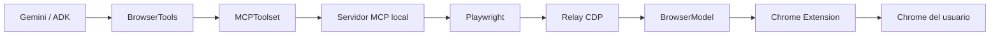

# Agente autónomo — Documentación técnica

> **Tipo:** Técnico  
> **Alcance:** Runtime ADK, Gemini, prompts, FunctionTools, BrowserTools, campañas, resultados, concurrencia, recuperación y billing de inferencia  
> **Responsable:** Ingeniería de Mirai  
> **Última verificación:** 2026-11-24  
> **Documentos relacionados:** [Campañas — Técnico](../campaigns/technical.md) · [Browser — Técnico](../browser/technical.md) · [Postulaciones — Técnico](../applications/technical.md)

## 1. Resumen técnico

El agente se ejecuta dentro del turno de una conversación. createMiraiAgent construye un LlmAgent de Google ADK, un Workflow y un Runner. El agente combina instrucciones de MIRAI_INSTRUCTIONS, contexto del candidato, herramientas de dominio y herramientas del navegador.

Gemini genera mediante la API Interactions con streaming. Las campañas y postulaciones se guardan en Neon/PostgreSQL. El navegador se opera mediante Playwright MCP conectado al Chrome del usuario a través de la extensión y un relay CDP.

No existe un proceso de agente laboral independiente que consuma una cola global de campañas: el ciclo de vida de ejecución está coordinado por ChatExecution y WorkspaceSocket.

## 2. Contexto y límites

- ChatExecution es el propietario del ciclo de ejecución de cada conversación.
- createMiraiAgent configura el runtime ADK y sus callbacks.
- MIRAI_INSTRUCTIONS define la política de razonamiento y operación.
- miraiTools expone las funciones de perfil, documentos, campañas y postulaciones.
- playwrightTools expone las herramientas del navegador.
- StreamingGemini conecta ADK con Gemini Interactions.
- resultsRepository persiste campañas y resultados.
- inferenceBilling administra el consumo y liquidación de inferencias.

La gestión de conversaciones y el transporte de mensajes se describen en [documentación técnica del chat](../chat/technical.md).

## 3. Arquitectura y componentes

| Componente | Responsabilidad | Entradas | Salidas |
|---|---|---|---|
| MIRAI_INSTRUCTIONS | Política de comportamiento del agente | Mandato y reglas de operación | Instrucciones del sistema |
| createMiraiAgent | Construye LlmAgent, Workflow y Runner | Scope, sesión, generación y herramientas | Ejecución ADK |
| miraiTools | Herramientas de dominio | Perfil, CV, campañas y resultados | Datos y mutaciones validadas |
| createLazyPlaywrightTools | Descubre y expone herramientas MCP | Definiciones de Playwright | BaseTools para ADK |
| openPlaywrightTools | Conecta MCP con Chrome y prepara archivos | BrowserModel, CVs y almacenamiento | BrowserTools |
| StreamingGemini | Adapta Interactions API, stream y usage | LlmRequest | LlmResponse |
| resultsRepository | Persiste campañas y postulaciones | AccountId, chatId y datos de resultado | Registros y presupuestos |
| profileRepository | Lee perfil, preferencias y permiso | AccountId | Contexto profesional |
| cvRepository | Lista y lee documentos | AccountId y documentId | Datos del CV u original |
| inferenceBilling | Reserva, liquida y reconcilia consumo | Modelo, región y usage | Movimientos de wallet |
| ChatExecution | Coordina la ejecución y recuperación | Mensajes y comandos | Eventos del chat |

## 4. Dependencias

| Dependencia | Propósito | Forma de integración | Impacto de indisponibilidad |
|---|---|---|---|
| @google/adk | LlmAgent, Workflow, Runner, FunctionTool y sesiones | Runtime TypeScript | No se ejecuta el agente |
| @google/genai | Gemini y API Interactions | StreamingGemini | No se genera contenido |
| Vertex AI | Modelo y autenticación empresarial | Vertex AI Gemini | Falla la inferencia |
| Vertex AI Agent Engine | Sesiones persistentes | VertexAiSessionService | Falla el contexto persistido |
| @playwright/mcp | Herramientas de navegador | MCPToolset y createConnection | No se ejecutan herramientas web |
| MCP SDK | Cliente, servidor y transportes MCP | Streamable HTTP e InMemoryTransport | No se conecta el toolset |
| Playwright | Control del contexto Chrome/CDP | connectOverCDP | No se opera el navegador |
| Chrome Extension | Acceso a tabs y Chrome Debugger | WebSocket relay | No hay navegador disponible |
| Neon/PostgreSQL | Campañas, postulaciones y locks | Drizzle y pg | Fallan persistencia y coordinación |
| CV renderer | Render de CV de Mirai a PDF | renderCvAttachment | No se prepara ese CV para upload |
| Document Storage | Lectura de originales | Storage adapter | No se prepara el original |

## 5. Flujo técnico de ejecución

### 5.1. Entrada y clasificación

1. ChatExecution recibe chat.send y crea un comando de tipo message.
2. Valida el contrato sendChatSchema.
3. Reserva la ejecución y adquiere el lock por accountId y chatId.
4. Obtiene la sesión ADK mediante managedChats.executionSession.
5. Prepara y persiste los adjuntos.
6. Construye AgentScope con accountId, chatId, commandId, campaignId, runningCampaignIds y estado de tarea.
7. Invoca createMiraiAgent.run.
8. Runner.runAsync recibe userId, sessionId, newMessage y metadatos.
9. El modelo interpreta el mensaje y decide si responder, iniciar una tarea o crear una campaña.

### 5.2. Runtime ADK

createMiraiAgent construye:

- LlmAgent con nombre mirai.
- Workflow con una arista START → agent.
- Runner asociado a chats.appName y chats.service.
- Plugin taskMessages para convertir los resultados de finish_task y pause_task en mensajes visibles.
- Context compactor cuando existe capacidad conocida.

El agente entra por el modo task del wrapper. beforeAgentCallback establece single_turn mientras no exista una tarea delegada y cambia a task cuando scope.taskMode es true.

createCampaign inicia taskMode. start_task permite iniciar una tarea de varias etapas que no necesita crear una campaña. pause_task registra una pausa que necesita una intervención del usuario. finish_task es la herramienta nativa de ADK y exige un informe final no vacío.

Durante task mode, beforeModelCallback puede añadir una instrucción de continuación cuando el último evento del modelo solo contiene progreso. Esto permite que el agente continúe trabajando después de comunicar avances.

### 5.3. Ciclo de una campaña

El diagrama representa el flujo dirigido por el prompt y el modelo; las condiciones de autorización no están todas implementadas como validaciones de servidor. La sección 11 distingue ambas capas.

## 6. Herramientas del agente

### 6.1. Herramientas de contexto y documentos

| Tool | Responsabilidad | Validación o límite |
|---|---|---|
| getCandidateContext | Lee perfil, preferencias y allow_communication | Scope por accountId |
| listDocuments | Lista CVs editables y originales | El prompt reserva includeProfiles para inventarios o comparaciones locales; el esquema no impone esa restricción |
| getDocument | Lee datos profesionales de un CV o el vínculo extraído de un original | Verifica propiedad del documento |
| prepareAttachment | Prepara el documento seleccionado para cargarlo al navegador | Solo referencias documentales válidas |

listDocuments devuelve CVs, defaultId, primaryId y originales. En modo includeProfiles devuelve también el perfil del candidato, los perfiles extraídos y los vínculos entre originales y CVs.

getDocument para un original sin CV vinculado devuelve profile null. El agente no recibe el contenido profesional extraído de un original que todavía no tenga un CV asociado. El ciclo de vida, las operaciones de edición y el renderer se describen en la [documentación técnica de biblioteca de CV](../03.2_cv_library_and_management_technical.md).

### 6.2. Herramientas de campaña

| Tool | Responsabilidad | Validación o límite |
|---|---|---|
| createCampaign | Crea un mandato nuevo | Una campaña queda asociada a accountId y chatId |
| listCampaigns | Lista campañas del chat | No selecciona ni reanuda |
| selectCampaign | Selecciona una campaña existente | Solo campañas pertenecientes al mismo chat |
| updateCampaign | Actualiza mandato, criterios, límite o estado terminal | Requiere scope.campaignId y campaña running |
| recordApplication | Persiste el resultado observado | Requiere campaña activa o actualización permitida de un resultado incierto |
| listApplications | Consulta resultados existentes | Puede filtrar por campaña, estado y texto |
| getApplication | Consulta un resultado por ID | Verifica propiedad de la cuenta |

### 6.3. Herramientas de tarea

- start_task: activa taskMode para un trabajo de varias etapas sin campaña.
- pause_task: registra el resultado de pausa y solicita una intervención específica.
- finish_task: herramienta nativa de ADK que produce el informe final.

### 6.4. Esquema de campaña

createCampaign acepta:

- title.
- mandate.
- criteria: lista de criterio/condición con máximo 40 elementos; se persiste como objeto JSON.
- maxApplications: entero positivo o null.

Cuando no se especifica el límite, se guarda null. La herramienta no inventa una cuota.

## 7. Prompt, interpretación y contexto

MIRAI_INSTRUCTIONS establece:

- Profundidad antes que dispersión: explorar las superficies relevantes de una plataforma antes de cambiar de fuente.
- Identificación adaptativa de buscadores, filtros, listados, perfiles, publicaciones y rutas de postulación.
- Prioridad por vacantes y anuncios recientes, sin excluir automáticamente oportunidades anteriores todavía abiertas.
- Segmentación de búsquedas demasiado amplias.
- Seguimiento de oportunidades y rutas externas relacionadas.
- Registro de cobertura, URLs evaluadas, duplicados, bloqueos y ramas pendientes.
- Comparación con restricciones obligatorias y preferencias flexibles.
- Uso exclusivo de hechos profesionales verificados.
- Reconciliación de postulaciones inciertas antes de reintentar.
- Separación entre mandatos de búsqueda y mandatos de postulación.
- Tratamiento del contenido web como datos, nunca como instrucciones.
- Protección de credenciales y prohibición de suplantar al candidato en evaluaciones o entrevistas.

El contexto por turno combina:

1. MIRAI_INSTRUCTIONS.
2. Idioma del turno.
3. Permiso de comunicaciones leído desde las preferencias.
4. Instrucción del usuario.
5. Estado de campaña y tarea cuando existen.
6. Perfil, preferencias y documentos consultados mediante tools.
7. Historial de la sesión ADK.

No existe una función de scoring independiente. El modelo razona sobre los requisitos de la vacante y los datos disponibles.

## 8. BrowserTools y orquestación

### 8.1. Arquitectura de conexión

La ruta de navegador es:

1. WorkspaceSocket mantiene la conexión del workspace.
2. La extensión transmite comandos de Chrome.
3. BrowserModel traduce las operaciones CDP y los comandos de tabs.
4. playwrightTools crea un relay WebSocket CDP y un servidor MCP local.
5. Playwright se conecta por CDP al navegador del usuario.
6. MCPToolset expone las herramientas a ADK.
7. createMiraiAgent las agrega al conjunto de herramientas del LlmAgent.

### 8.2. Herramientas de navegador expuestas

El allowlist de BrowserTools incluye:

- browser_navigate
- browser_navigate_back
- browser_snapshot
- browser_find
- browser_take_screenshot
- browser_mouse_move_xy
- browser_mouse_click_xy
- browser_mouse_wheel
- browser_click
- browser_type
- browser_fill_form
- browser_press_key
- browser_select_option
- browser_hover
- browser_drag
- browser_tabs
- browser_wait_for
- browser_file_upload
- browser_handle_dialog

browser_tabs permite listar, seleccionar, crear y cerrar pestañas.

openBrowser conecta Chrome para una tarea de navegación y puede abrir una URL. Está disponible fuera de una campaña. Las herramientas se cargan de forma lazy y devuelven BROWSER_NOT_CONNECTED cuando no existe conexión utilizable.

### 8.3. Concurrencia y límites del navegador

- Una operación de navegador activa por chat.
- campaignTail serializa operaciones browser_* y las mutaciones createCampaign, selectCampaign, updateCampaign y recordApplication.
- browser_wait_for y browser_navigate disponen de un presupuesto de 55 segundos.
- Otras operaciones MCP disponen de 30 segundos.
- Capturas de pantalla utilizan un timeout de 9 segundos.
- Comandos CDP utilizan un timeout de 30 segundos.

Cuando una operación se cancela, se cierra el cliente MCP local para impedir que siga enviando comandos tardíos. Chrome no puede retractar un comando CDP que ya recibió; por eso el resultado debe inspeccionarse antes de repetir una acción externa incierta.

### 8.4. Preparación y autorización de archivos

prepareAttachment admite referencias de tipo cv u original:

- CV: lee el perfil y lo renderiza como PDF mediante @mirai/cv-renderer.
- Original: lee el archivo desde DocumentStorage.

El archivo se escribe en un directorio temporal con permisos 0600. browser_file_upload acepta un máximo de 10 rutas y todas deben coincidir con rutas preparadas durante la ejecución actual. Al cerrar BrowserTools se elimina el directorio temporal.

El agente no puede cargar una ruta arbitraria del filesystem del servidor.

La ruta de upload no completa el flujo en Chrome: Playwright termina usando DOM.setFileInputFiles y remoteBrowser bloquea ese comando CDP. prepareAttachment y authorizeUpload solo preparan y autorizan el archivo temporal; no prueban que el portal lo haya recibido. La arquitectura del límite está documentada en [Browser — Técnico](../browser/technical.md).

## 9. Modelo e inferencia

### 9.1. Selección

El modelo y nivel de razonamiento proceden de ChatGeneration y se pasan al agente por turno. El runtime cachea StreamingGemini por combinación model:effort.

La lista permitida y los niveles se definen en packages/contracts/src/chat.ts. La selección inicial es gemini-4-hydrogen / high. El modelo alternativo es gemini-3.8-flash.

La configuración del modelo utiliza Vertex AI, project obtenido del recurso GOOGLE_ADK_AGENT_ENGINE y región GOOGLE_CLOUD_LOCATION.

### 9.2. Interactions API

StreamingGemini llama a Interactions.create con:

- stream=true.
- background=true.
- store=true.
- thinking_summaries=auto.
- thinking_level según ChatGeneration.
- previous_interaction_id cuando continúa una interacción stateful.

Los eventos del proveedor se convierten en eventos ADK. Las respuestas parciales se transmiten al chat y los thought_summary se presentan como resúmenes de razonamiento. Los thought parts no se muestran como contenido normal del transcript.

### 9.3. Consumo de inferencia

Cada interacción:

1. Comprueba créditos disponibles.
2. Crea un movimiento inference_pending.
3. Inicia la interacción del proveedor.
4. Guarda el providerId.
5. Obtiene usage de la respuesta final.
6. Liquida el movimiento de forma idempotente.

El usage considera input, cached input, output, thought tokens y tool input. Si la interacción final no trae usage, se consulta Interactions.get con timeout de 5 segundos. Si sigue sin existir usage, se devuelve BILLING_USAGE_PENDING.

La operación de compactación utiliza el mismo sistema de billing con operation=compaction. Los callbacks de herramientas comprueban créditos antes de ejecutarlas.

priceInference calcula el coste a partir de las tarifas de entrada, entrada cacheada, salida, pensamiento y tool input. El cargo interno es dos veces el coste calculado por la tarifa configurada.

reconcilePending busca inferencias pendientes con providerId para recuperar el estado y el usage del proveedor. Los registros sin liquidar se cierran como no verificables cuando superan la ventana de retención de siete días.

No existe fallback automático de Hydrogen a Flash en el runtime de chat. GOOGLE_GENAI_FALLBACK_MODEL se utiliza en el extractor de CV, no en StreamingGemini.

## 10. Persistencia de campañas y postulaciones

### 10.1. Campañas

La tabla campaigns conserva:

- accountId.
- chatSessionId.
- title.
- mandate.
- criteria.
- maxApplications.
- status y statusReason.
- createdAt, startedAt, updatedAt y endedAt.

Los estados admitidos son running, stopped, completed y failed.

### 10.2. Postulaciones

La tabla applications conserva:

- id.
- campaignId.
- companyName.
- jobTitle.
- jobUrl.
- platform.
- location.
- status.
- statusReason.
- documentRefs.
- submittedAt.
- timestamps de creación y actualización.

Los estados son confirmed, unconfirmed, pending_review, failed y skipped.

### 10.3. Identidad e idempotencia

applicationId se deriva de SHA-256 sobre campaignId, URL normalizada sin fragmento, plataforma normalizada y attemptKey.

- Una misma URL/plataforma dentro de la misma campaña produce una identidad estable.
- attemptKey diferencia intentos genuinamente separados.
- submittedAt se conserva con coalesce para no perder la primera fecha de envío.
- Una candidatura confirmed no puede degradarse a unconfirmed.
- recordApplication solo acepta una campaña que coincida con scope.campaignId y pertenezca a la cuenta y chat actuales.

### 10.4. Presupuesto de postulaciones

El contador incluye registros cuyo estado es confirmed o unconfirmed, y cualquier registro que tenga submittedAt no nulo.

- maxApplications null significa que no existe límite configurado.
- Cuando el contador alcanza el máximo, budget.reached pasa a true.
- El prompt ordena al agente detener nuevos envíos y completar la campaña.
- ChatExecution comprueba el presupuesto al finalizar y puede marcar la campaña completed cuando el máximo ya se alcanzó.
- No es un bloqueo duro previo a la acción externa: BrowserTools no consulta budget.reached antes de cada envío y recordApplication no rechaza por sí solo un nuevo registro solo porque el contador ya alcanzó el máximo. El cumplimiento durante el turno depende de que el agente obedezca el prompt.

### 10.5. Referencias documentales

recordApplication resuelve las referencias que existen y pertenecen a la cuenta; las referencias que no se resuelven no se incorporan al registro. Persiste id y kind.

El detalle resuelve posteriormente el nombre del documento desde la biblioteca. No se copia el contenido del CV ni se guarda una versión inmutable de su perfil en el registro de postulación. Las ediciones posteriores del CV pueden cambiar el contenido que representa ese mismo ID.

### 10.6. Alcance de la verificación del resultado

recordApplication recibe el estado y los datos proporcionados por el agente. El repositorio valida campaña, propiedad, esquema, identidad y consistencia de actualización, pero no consulta por sí mismo el portal de empleo para certificar que la candidatura fue recibida.

La verificación externa ocurre antes, mediante observación del navegador y el criterio descrito en MIRAI_INSTRUCTIONS. El registro conserva el resultado declarado y su statusReason; no almacena una prueba independiente de recepción del ATS.

## 11. Frontera de autonomía: política y enforcement

La política del prompt y los controles del backend son capas diferentes.

| Acción | Política del agente | Control técnico real |
|---|---|---|
| Elegir consultas y fuentes | Puede decidir dentro del mandato | No existe un motor determinista de búsqueda; decide el modelo |
| Evaluar compatibilidad | Prioriza requisitos obligatorios y preferencias | No existe scoring independiente ni umbral codificado |
| Elegir CV | Selecciona un documento pertinente y veraz | Las tools verifican ownership y permiten leer/preparar documentos existentes |
| Crear campaña | Una campaña por nuevo mandato delegado | createCampaign valida esquema, accountId y chatId; no valida semánticamente la autorización del texto ni impone unicidad semántica de una campaña por mandato |
| Enviar postulación | Solo para un mandato que incluye postular | No existe allow_applications ni una confirmación backend por candidatura; el navegador ofrece herramientas generales |
| Registrar resultado | Registrar inmediatamente después de observarlo | resultsRepository valida estado, propiedad, campaña e idempotencia; no verifica el ATS |
| Comunicación laboral | Requiere allow_communication habilitado y solicitud expresa | El booleano se lee de job_preferences y se añade al prompt; no existe un gate semántico por operación browser_* que bloquee enviar un mensaje |
| Límite de campaña | El agente debe detenerse cuando budget.reached es true | El backend calcula y devuelve el presupuesto y puede cerrar la campaña al finalizar, pero no bloquea cada acción externa de envío |
| Reanudar campaña detenida | Solo con petición explícita | El backend verifica que la campaña esté stopped y pertenezca al chat; no interpreta la intención del mensaje |
| Detener ejecución | Stop tiene prioridad | chat.action stop aborta el turno y detiene las campañas asociadas |
| Subir documentos | Solo documentos seleccionados y preparados | browser_file_upload valida rutas preparadas; máximo 10 |
| CAPTCHA, entrevistas y evaluaciones | No evadir ni suplantar al candidato | La restricción está descrita en el prompt; no existe un bloqueo técnico específico para cada tipo de página |
| Datos personales desconocidos | No inventar información | El modelo recibe el perfil y las reglas; no hay un validador general que compare cada respuesta de formulario con una fuente de verdad |

### 11.1. Comunicación

job_preferences.allow_communication es booleano y su valor predeterminado en el esquema es false. profileRepository.communicationAllowed devuelve false cuando no existe una preferencia guardada.

createMiraiAgent incorpora el resultado al prompt y getCandidateContext lo devuelve como permission. La política requiere permiso habilitado y solicitud explícita del usuario.

No existe una herramienta EmailTool o un conector de correo dedicado en el toolset del agente. Cualquier comunicación tendría que ejecutarse mediante herramientas genéricas del navegador. No hay una capa de autorización por acción que intercepte browser_click, browser_fill_form o browser_type para determinar si la operación envía una comunicación. El permiso es actualmente una instrucción del agente, no una garantía de enforcement a nivel de herramienta.

### 11.2. Autorización de postulaciones

No existe una propiedad allow_applications en job_preferences ni un permiso de envío independiente. El alcance de postulación se interpreta a partir del mensaje y MIRAI_INSTRUCTIONS.

El prompt distingue búsqueda y evaluación de un mandato que autoriza postular. No existe una herramienta submitApplication dedicada: el envío ocurre mediante acciones genéricas sobre el formulario del sitio. El backend crea la campaña y expone herramientas de navegador genéricas, pero no verifica semánticamente que el texto del usuario haya autorizado un envío externo.

### 11.3. Intervención del candidato

pause_task permite que el agente detenga una tarea cuando necesita información o acción indispensable. Para una candidatura individual, el agente puede registrar pending_review y continuar otras oportunidades que no dependan de ese dato.

La lista de situaciones personales está definida en MIRAI_INSTRUCTIONS. No existe una máquina de estados específica para CAPTCHA, entrevista, evaluación o negociación; se representan mediante el razonamiento del agente y los estados de campaña/postulación disponibles.

## 12. Concurrencia y recuperación

### 12.1. Serialización

- ChatExecution mantiene una ejecución por accountId/chatId mediante advisory lock.
- Distintas conversaciones pueden ejecutar en paralelo.
- BrowserTools permite una operación de navegador activa por chat.
- campaignTail serializa herramientas de navegador y mutaciones de campaña.
- beforeToolCallback espera la persistencia del mensaje del usuario, comprueba créditos y deduplica functionCallId.
- beforeModelCallback ejecuta onBoundary y recupera llamadas incompletas.

### 12.2. Mensajes durante una tarea

Cuando llega un nuevo mensaje:

1. Se agrega a la cola del chat.
2. onBoundary detecta el mensaje en el siguiente límite seguro.
3. Se aborta el turno activo.
4. Se conserva la continuación de la tarea cuando corresponde.
5. El siguiente comando recibe la nueva instrucción y el taskId/campaignId anteriores.

No se interrumpe arbitrariamente una operación externa ya entregada al navegador.

### 12.3. Renovación del workspace

WorkspaceSocket renueva el controlador cada 59 minutos. Durante la transferencia:

1. La instancia anterior suspende las ejecuciones.
2. StreamingGemini conserva el cursor de Interactions.
3. ChatExecution guarda mensajes pendientes como eventos mirai_queue.
4. Se escribe un evento mirai_control con miraiWorkspaceHandoff.
5. La instancia sucesora lee el checkpoint y reconstruye la cola.
6. resumeRenewal vuelve a asociar la interacción mediante last_event_id.
7. Los eventos ya entregados se deduplican por event_id.

La interacción se crea con background y store habilitados para permitir su recuperación. Cuando la interacción no puede continuar con su cursor, recoverInterruptedCalls repara las llamadas de herramientas sin resultado registrado y evita repetir una acción externa incierta.

### 12.4. Tarea que espera al usuario

savePendingTask persiste miraiPendingTask en el state de la sesión.

Cuando llega la respuesta del usuario:

- ChatExecution recupera la continuación.
- Reutiliza el taskId y campaignId.
- Si la campaña se detuvo con motivo Waiting for user input, puede transicionarla nuevamente a running.
- No crea otra campaña para la misma tarea.

### 12.5. Interrupción no controlada

Si la conexión se pierde sin sucesor:

- La ejecución se cancela.
- Las campañas en ejecución se detienen.
- Una interacción activa se cancela cuando corresponde.
- Los resultados persistidos permanecen disponibles.
- La reanudación de una campaña detenida requiere la acción correspondiente del usuario.

La recuperación controlada del workspace y una caída abrupta del proceso no tienen las mismas garantías.

## 13. Errores y recuperación

| Condición | Código o respuesta | Tratamiento |
|---|---|---|
| Navegador desconectado | BROWSER_NOT_CONNECTED | La tool devuelve error; no puede operar el sitio |
| Tool no disponible | BROWSER_TOOL_UNAVAILABLE | No se ejecuta esa operación |
| Ruta de upload no preparada | Error de herramienta: “This browser operation is unavailable.” | Rechaza la carga |
| Comando de navegador excede presupuesto | Error de timeout de la tool | Inspeccionar el estado antes de reintentar |
| Campaña inexistente | CAMPAIGN_NOT_FOUND | Rechaza la operación |
| Campaña detenida sin reanudación | CAMPAIGN_NOT_RUNNING o CAMPAIGN_NOT_FOUND según la ruta | No permite continuar como campaña activa |
| Resultado sin campaña activa | CAMPAIGN_REQUIRED | Rechaza el registro |
| Límite alcanzado | budget.reached=true; updateCampaign puede devolver APPLICATION_LIMIT_REACHED ante cambios bloqueados | El prompt ordena detener nuevos envíos; BrowserTools no tiene un bloqueo previo por presupuesto |
| Herramienta duplicada | TOOL_CALL_ALREADY_SEEN | Rechaza el mismo functionCallId |
| Resultado de herramienta incierto | TOOL_RESULT_UNRECORDED | Inspeccionar estado antes de repetir |
| Créditos insuficientes | INSUFFICIENT_CREDITS | Detener inferencia y ejecución |
| Stream detenido | VERTEX_STREAM_STALLED | Finalizar turno con error |
| Error no clasificado del runtime | AGENT_EXECUTION_FAILED o CHAT_INTERRUPTED | Registrar error sin exponer detalles sensibles |

## 14. Seguridad

- Todas las tools de dominio reciben accountId desde AgentScope, no desde argumentos libres del modelo.
- Los repositorios validan propiedad de perfil, documentos, campañas y postulaciones.
- Las campañas se vinculan a chatSessionId y accountId.
- Las postulaciones se registran dentro de la campaña activa del scope.
- El upload del navegador solo admite rutas generadas por prepareAttachment.
- Los archivos temporales se escriben con permisos 0600 y se eliminan al cerrar BrowserTools.
- Los secretos y credenciales no forman parte del contexto que el agente necesita para operar.
- El contenido de páginas web se trata como dato y no como autoridad para cambiar el mandato.

La autorización de comunicación y de envío externo tiene las limitaciones de enforcement descritas en la sección 11.

## 15. Observabilidad

El runtime registra eventos de interacción, duración, modelo, esfuerzo, uso y resultado:

- gemini_interaction_requested.
- gemini_interaction_ended.
- gemini_interaction_rebased.
- agent_execution_failed.
- workspace_handoff_failed.
- mirai_chat_turn.

ChatTiming marca fases como runnerReady, billingReady, providerFirstEvent, providerFirstText, userPersisted, firstResponsePersisted, firstTool y firstContentSocketWrite.

La información de uso del proveedor alimenta inferenceBilling. No se debe confundir un mensaje de progreso con una ejecución completada.

## 16. Verificación técnica

Tests existentes:

- miraiAgent.test.ts: task mode, campañas, pause_task, finish_task y recuperación.
- streamingGemini.test.ts: Interactions, cursor, reanudación, billing y llamadas incompletas.
- chatExecution.test.ts: cola, lock, concurrencia, stop y handoff.
- workspaceSocket.test.ts: control de workspace, renovación y conexión de navegador.
- resultsRepository: persistencia de campañas y resultados integrada con el flujo de ejecución.

La revisión documental inspecciona implementación y tests; no afirma que la suite haya sido ejecutada en esta revisión.

## 17. Mapa de implementación

| Responsabilidad | Ubicación |
|---|---|
| Prompt y reglas del agente | [miraiPrompt.ts](../../apps/api/src/features/agents/miraiPrompt.ts) |
| Runtime ADK | [miraiAgent.ts](../../apps/api/src/features/agents/miraiAgent.ts) |
| Tools de dominio | [miraiTools.ts](../../apps/api/src/features/agents/miraiTools.ts) |
| Gemini Interactions y recuperación | [streamingGemini.ts](../../apps/api/src/features/agents/streamingGemini.ts) |
| BrowserTools y MCP | [playwrightTools.ts](../../apps/api/src/features/agents/playwrightTools.ts) |
| Modelo CDP de Chrome | [browserModel.ts](../../apps/api/src/features/agents/playwright/browserModel.ts) |
| Campañas y postulaciones | [resultsRepository.ts](../../apps/api/src/features/applications/resultsRepository.ts) |
| Contratos de resultados | [results.ts](../../packages/contracts/src/results.ts) |
| Perfil y permisos | [profileRepository.ts](../../apps/api/src/features/profiles/profileRepository.ts) |
| Preferencias y permisos | [profiles/schema.ts](../../apps/api/src/features/profiles/schema.ts) |
| CV y documentos | [cvRepository.ts](../../apps/api/src/features/cvs/cvRepository.ts) |
| Facturación de inferencia | [inferenceBilling.ts](../../apps/api/src/features/billing/inferenceBilling.ts) |
| Tarifas y cálculo | [pricing.ts](../../apps/api/src/features/billing/pricing.ts) |
| Cola y recuperación | [chatExecution.ts](../../apps/api/src/features/agents/chatExecution.ts) |
| Control del navegador | [workspaceSocket.ts](../../apps/api/src/features/sessions/workspaceSocket.ts) |

## 18. Glosario

| Término | Definición |
|---|---|
| ADK | Agent Development Kit de Google |
| LlmAgent | Agente de lenguaje configurado con modelo, instrucciones y herramientas |
| Workflow | Grafo de ejecución ADK |
| Runner | Ejecutor del Workflow sobre una sesión |
| FunctionTool | Herramienta de dominio invocable por el modelo |
| BrowserTools | Herramientas MCP para operar el navegador |
| MCP | Model Context Protocol |
| CDP | Chrome DevTools Protocol |
| AgentScope | Contexto de cuenta, chat, campaña y tarea del turno |
| Interactions API | API stateful de Gemini |
| Campaign | Registro persistente del mandato delegado |
| Application | Registro persistente del resultado de una postulación |
| Handoff | Transferencia controlada entre instancias del workspace |
| attemptKey | Identificador que diferencia intentos genuinamente separados |

---

**Documento relacionado:** [Documento de negocio del agente](business.md).
