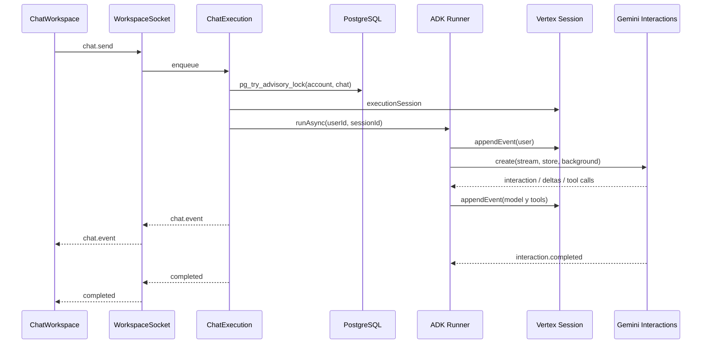

# Chat y espacio conversacional — Documentación técnica

> **Tipo:** Técnico  
> **Alcance:** API de conversaciones, sesiones ADK, ejecución, streaming, persistencia, adjuntos, paginación y recuperación  
> **Responsable:** Ingeniería de Mirai  
> **Última verificación:** 2026-11-24  
> **Base de verificación:** main, commit 7431b98

## 1. Resumen técnico

El chat se implementa como una capa de gestión y ejecución sobre sesiones de Google ADK. Las sesiones persistentes residen en Vertex AI Agent Engine mediante VertexAiSessionService. El backend coordina la ejecución, la cola de mensajes, el streaming y el control del workspace. La interfaz consume REST para historial y administración, y WebSocket para ejecución en vivo.

El runtime del agente se encuentra integrado en el ciclo de ejecución del chat. La conversación no tiene un servicio de generación independiente del agente.

## 2. Contexto y límites

- El frontend administra el compositor, la lista de conversaciones, el transcript, el selector de generación y el estado en vivo.
- La API administra sesiones, ownership, historial y adjuntos.
- ChatExecution coordina turnos, mensajes encolados, locks, estado en vivo y handoffs.
- createMiraiAgent configura ADK y ejecuta el modelo y sus herramientas.
- StreamingGemini adapta la API Interactions de Gemini al flujo de generación de ADK.
- WorkspaceSocket mantiene el controlador de cuenta y conecta el navegador cuando está disponible.

La lógica de descubrimiento de oportunidades, selección de CV, formularios y postulaciones pertenece al dominio Agent; se describe en [documentación técnica del agente](../agent/technical.md).

## 3. Arquitectura y componentes

| Componente | Responsabilidad | Entradas | Salidas |
|---|---|---|---|
| ChatWorkspace | Compositor, envío, estado, historial y acciones del usuario | Mensajes, archivos, selección de generación | Solicitudes REST y frames WebSocket |
| ChatNavigation | Lista, selección, renombrado y eliminación | Cuenta y acciones del usuario | Consultas y mutaciones REST |
| ChatTranscript | Historial, actividad, respuestas y paginación visual | ChatEvent y estado de turno | Vista cronológica |
| ChatGenerationProvider | Selección activa de modelo y razonamiento | Selección del usuario | ChatGeneration |
| ChatDraftsProvider | Borradores de texto por conversación | Texto no enviado | Estado en memoria del frontend |
| chatRoutes | API REST de conversaciones y adjuntos | HTTP autenticado | JSON y contenido de archivos |
| managedChats | Adaptador de sesiones ADK | Cuenta, sessionId, historial | Sesiones y eventos de Vertex AI |
| chatExecution | Cola, locks, turnos, estado y recuperación | Comandos del workspace | ChatStream |
| createMiraiAgent | Configuración de LlmAgent, Workflow y Runner | Scope, generación, sesión y herramientas | Eventos ADK |
| StreamingGemini | Interactions API, streaming, cursor y usage | LlmRequest | LlmResponse y eventos parciales |
| chatEvents | Conversión y sanitización de eventos | Eventos ADK o del proveedor | ChatEvent |
| chatAttachments | Validación, persistencia y restauración de adjuntos | Archivos codificados y referencias | Part de Gemini y referencias persistentes |
| workspaceSocket | Controlador de cuenta y transporte en vivo | Frames del cliente y navegador | Frames del servidor |

## 4. Dependencias

| Dependencia | Propósito | Integración | Impacto de indisponibilidad |
|---|---|---|---|
| Google ADK | LlmAgent, Workflow, Runner y SessionService | Runtime del backend | No se ejecuta el agente |
| Vertex AI Agent Engine | Persistencia de sesiones y eventos | VertexAiSessionService y REST | No se puede recuperar o persistir la conversación |
| Gemini Interactions API | Generación stateful y streaming | StreamingGemini | El turno falla o se interrumpe |
| Google Auth | Acceso a Vertex AI | GoogleAuth con cloud-platform | Fallan consultas de historial |
| Neon/PostgreSQL | Adjuntos, locks y control de workspace | Drizzle y pg Client | Fallan persistencia auxiliar y coordinación |
| Almacenamiento de documentos | Archivos originales PDF/DOCX | DocumentStorage | No se pueden restaurar esos adjuntos |
| Chrome Extension | Acceso al navegador del usuario | WebSocket y CDP relay | No se ejecutan operaciones de navegador |
| TanStack Query | Caché e historial del frontend | Queries y mutations | La interfaz no sincroniza datos |

## 5. Flujos técnicos

### 5.1. Crear conversación y enviar el primer mensaje

1. El usuario envía un mensaje desde ChatWorkspace.
2. Si no existe chatId, el frontend llama a POST /v1/chats.
3. El título inicial utiliza el texto o nombre del primer archivo y se limita a 120 caracteres en el frontend.
4. La API crea una sesión ADK con state.title y el TTL configurado.
5. El frontend envía chat.send por /v1/workspace.
6. WorkspaceSocket valida el frame, la identidad y la propiedad del controlador.
7. ChatExecution reserva la ejecución y adquiere el advisory lock de la conversación.
8. ChatExecution obtiene la sesión y prepara los adjuntos.
9. createMiraiAgent construye el runtime y Runner.runAsync inicia el turno.
10. ADK persiste el evento del usuario y las respuestas.
11. StreamingGemini consume Gemini Interactions y adapta sus eventos.
12. ChatExecution emite eventos chat.event por WebSocket.
13. El frontend acumula deltas y actualiza el transcript.

### 5.2. Aceptación y ejecución

WorkspaceSocket envía el frame accepted antes de que la promesa de enqueue termine. Ese frame confirma la admisión del comando en el transporte; no significa que el modelo haya respondido ni que la escritura final del turno haya terminado.

La ejecución comunica por separado:

- status con working=true y el turno activo.
- event con contenido parcial o completo.
- context con uso y capacidad del contexto.
- completed cuando existe una respuesta final de texto y el turno termina correctamente.
- status con working=false al cerrar o interrumpir la ejecución.

### 5.3. Mensajes encolados

- enqueue deduplica mensajes por message.id respecto al turno y a la cola local.
- Cada conversación tiene una cola de comandos en memoria durante la ejecución.
- Si llega un mensaje mientras el agente trabaja, onBoundary detecta la cola y aborta el turno actual en el siguiente límite seguro.
- Las operaciones de navegador y mutaciones de campaña pasan por la cola serial campaignTail.
- La siguiente instrucción se ejecuta dentro de la misma conversación y puede continuar la tarea activa.

Los mensajes pendientes se vuelven persistentes cuando se realiza un handoff de workspace: se guardan como eventos mirai_queue y se agrega un checkpoint miraiWorkspaceHandoff. Antes de ese checkpoint, la cola normal vive en memoria del proceso. Una caída abrupta del proceso antes de persistir el handoff no ofrece la misma garantía de recuperación que una renovación controlada.

### 5.4. Historial y paginación

GET /v1/chats/:id/history:

1. Verifica ownership mediante authorizeRead.
2. Obtiene credenciales de GoogleAuth.
3. Consulta el endpoint de eventos de la sesión en Vertex AI.
4. Solicita pageSize=24 y orderBy=timestamp desc.
5. Aplica pageToken cuando existe cursor.
6. Valida los eventos con providerEventSchema.
7. Convierte eventos mediante fromProviderEvent.
8. Invierte la página para devolver orden cronológico.
9. Devuelve nextPageToken, contexto y error cuando corresponda.

El frontend utiliza una infinite query. Los mensajes anteriores se cargan al llegar al inicio del transcript y la posición de scroll se conserva. La caché del historial usa staleTime Infinity y desactiva refetch por foco y reconexión; las transiciones de ejecución invalidan las consultas relevantes.

### 5.5. Administración de conversaciones

| Operación | Contrato | Comportamiento |
|---|---|---|
| Listar | GET /v1/chats | service.listSessions filtrado por userId |
| Crear | POST /v1/chats | service.createSession con state.title y TTL |
| Historial | GET /v1/chats/:id/history | Paginación de eventos de Vertex |
| Estado | GET /v1/chats/:id/status | Última campaña del chat y capacidad de contexto |
| Renombrar | PATCH /v1/chats/:id | appendEvent con stateDelta.title |
| Eliminar | DELETE /v1/chats/:id | deleteSession; rechaza si execution.isWorking |

La sesión usa accountId como userId y chatId como sessionId. managedChats.owned verifica que la sesión pertenezca al usuario autenticado.

### 5.6. Acciones del chat

El frame chat.action admite:

- stop: cancela la ejecución del chat activo.
- compact: ejecuta compactación manual.
- resume: reanuda una campaña detenida identificada por campaignId.

La reanudación valida que la campaña pertenezca a la cuenta y al chat y que su estado sea stopped.

## 6. Contratos e interfaces

### REST

| Método y ruta | Función |
|---|---|
| GET /v1/chats | Lista sesiones del usuario |
| POST /v1/chats | Crea una sesión |
| GET /v1/chats/:id/history | Recupera una página de eventos |
| GET /v1/chats/:id/status | Recupera campaña y contexto |
| PATCH /v1/chats/:id | Renombra una sesión |
| DELETE /v1/chats/:id | Elimina una sesión |
| GET /v1/chats/attachments | Lista imágenes persistidas en queued_chat_attachments |
| GET /v1/chats/:id/attachments/:messageId/:position | Lee un adjunto almacenado |
| DELETE /v1/chats/:id/attachments/:messageId/:position | Elimina una fila de adjunto |

### WebSocket

Ruta: /v1/workspace.

Frames de cliente relevantes:

- open
- chat.send
- chat.action
- control.attach
- control.keepalive
- control.restore
- control.release
- browser.frame
- browser.closed

Frames de servidor relevantes:

- control.ready
- control.attached
- control.renew
- control.lost
- accepted
- error
- chat.event
- browser.frame
- browser.reset
- control.idle
- billing.changed
- results.changed

ChatStream distingue event, completed, context y status.

### Contrato de envío

sendChatSchema valida:

- id e instanceId UUID.
- locale en o es.
- text con máximo de 30.000 caracteres.
- generation opcional.
- máximo 20 adjuntos.
- máximo 10 imágenes y 10 documentos.
- máximo 42.000.000 caracteres Base64 agregados.
- al menos texto o un adjunto.

El esquema de adjuntos admite image/jpeg, image/png, image/webp, application/pdf y DOCX.

## 7. Modelo de datos y propiedad

### 7.1. Sesiones

La fuente de verdad de mensajes, eventos ADK y estado de sesión es Vertex AI Agent Engine.

- appName procede del recurso GOOGLE_ADK_AGENT_ENGINE.
- userId corresponde a accountId.
- sessionId corresponde a chatId.
- state.title conserva el título.
- Los eventos ADK conservan mensajes, respuestas, llamadas a herramientas y metadatos.
- El TTL por defecto es 7776000 segundos (90 días), configurable con GOOGLE_ADK_SESSION_TTL.

### 7.2. Caché de ejecución

managedChats mantiene una caché local por cuenta y conversación:

- Solo reutiliza una sesión del mismo workspace no abortado.
- No cachea sesiones con más de 240 eventos.
- No cachea sesiones cuyo JSON serializado supere 1 MB.
- Mantiene como máximo 12 entradas.
- La caché es una optimización; Vertex AI sigue siendo la fuente persistente.

### 7.3. Adjuntos

La persistencia diferencia imágenes y documentos:

| Tipo | Persistencia | Restauración |
|---|---|---|
| Imágenes | Base64 en queued_chat_attachments de Neon | Consulta por cuenta, chat, mensaje y posición |
| PDF/DOCX | Object storage y originalDocuments | Lectura del objeto referenciado por originalId |

chatAttachments.save valida referencias de documentos existentes, prepara originales nuevos y persiste imágenes. restore reconstruye el mensaje desde las referencias guardadas.

Límites del contrato y procesamiento:

- Imagen: 15 MiB por archivo.
- PDF/DOCX: 10 MiB por archivo.
- Selección del frontend: máximo 30 MiB combinados.
- Envío: 20 archivos, máximo 10 por categoría.
- Límite de imágenes persistidas: 30 por cuenta.
- Los documentos originales consumen la capacidad de originales de la cuenta.

Las imágenes se validan por firma de archivo. PDF y DOCX pasan por documentPart antes de convertirse en contenido de Gemini.

### 7.4. Límite de eliminación

DELETE /v1/chats/:id elimina la sesión ADK. La ruta no invoca attachments.remove ni elimina los objetos originales asociados. queued_chat_attachments tiene una clave primaria compuesta, pero no declara una relación de borrado en cascada con la sesión ADK.

Por tanto, eliminar una conversación no equivale a purgar automáticamente todas las filas de imágenes y todos los originales asociados. La documentación no debe prometer ese comportamiento.

## 8. Estados, concurrencia y consistencia

### 8.1. Exclusión por conversación

ChatExecution adquiere una conexión PostgreSQL dedicada y ejecuta pg_try_advisory_lock sobre executionLockKey(accountId, chatId).

- Una conversación admite una ejecución activa.
- Una segunda ejecución sobre la misma clave recibe EXECUTION_ALREADY_ACTIVE.
- Conversaciones distintas utilizan claves distintas y pueden ejecutarse en paralelo.
- El lock se mantiene mientras vive la conexión.
- Un error o cierre inesperado de la conexión cancela la ejecución.

### 8.2. Controlador de cuenta

ControllerRepository mantiene un controlador activo por cuenta mediante users.account_controllers y advisory locks.

- Una cuenta tiene una instancia controladora activa.
- Una nueva instancia requiere control válido o transferencia.
- La transferencia notifica a la instancia anterior.
- El handoff espera a que la ejecución anterior haya cancelado o persistido su estado.

### 8.3. Ciclo del workspace

- Renovación programada: 59 minutos.
- Inactividad: 10 minutos sin comandos, restauraciones ni chats activos.
- Heartbeat: cada 20 segundos.
- Timeout inicial de conexión: 10 segundos.

Durante una renovación controlada, ChatExecution suspende el turno, conserva el cursor de interacción y escribe el checkpoint antes de cerrar la instancia anterior.

### 8.4. Estado de turno

Las fases admitidas por ChatTurn son:

- session
- waiting
- reasoning
- text
- tools

El estado working pertenece al stream del workspace; no es un campo persistido de la sesión. El resultado final se comunica mediante un frame completed, separado del evento de mensaje.

## 9. Generación, selección de modelo y compactación

### 9.1. Modelos y razonamiento

La fuente de verdad del contrato es packages/contracts/src/chat.ts.

| Modelo | Niveles admitidos |
|---|---|
| gemini-4-hydrogen | low, medium, high, xhigh |
| gemini-3.8-flash | low, medium, high |

Selección inicial: gemini-4-hydrogen / high.

La interfaz mantiene la selección en ChatGenerationProvider mediante estado React. El provider vive en el workspace y se reinicia cuando se monta de nuevo; no escribe la preferencia en la base de datos. La selección se envía en cada chat.send.

El backend crea o reutiliza StreamingGemini por combinación de modelo y nivel. El modelo usa Vertex AI y la API Interactions, con thinking_summaries:auto y thinking_level.

La generación histórica no expone un campo de modelo o esfuerzo en ChatEvent. El evento normal del usuario persiste el commandId y otros metadatos de ejecución, no una copia visible de ChatGeneration.

GOOGLE_ADK_MODEL o GOOGLE_GENAI_MODEL determinan el modelo de servidor por defecto cuando el cliente no envía generation. El valor predeterminado del código es gemini-4-hydrogen.

GOOGLE_GENAI_FALLBACK_MODEL no configura un fallback del chat. Esa variable se utiliza en el extractor de CV. StreamingGemini no cambia automáticamente a Flash cuando falla una generación de chat.

### 9.2. Capacidad y compactación

managedChats declara una ventana de contexto de 1.048.576 tokens para los dos modelos admitidos.

- Compactación automática: threshold = floor(capacity × 0,8).
- Retención de eventos: eventRetentionSize = 6.
- El summarizer preserva mandato activo, restricciones estrictas, instrucciones recientes, decisiones, acciones sin resolver e IDs persistidos.
- El resumen debe conservar la incertidumbre sobre postulaciones y no inventar resultados.
- La compactación manual utiliza threshold 1 para forzar el compactor.
- La compactación manual requiere créditos y se factura como operación compaction.
- Después de compactar, la caché local de ejecución se invalida y el frontend recibe un nuevo evento context.

## 10. Errores y recuperación

| Código o condición | Detección | Comportamiento |
|---|---|---|
| AUTH_REQUIRED | Token ausente o inválido | Rechaza REST o apertura del workspace |
| AGENT_NOT_CONFIGURED | No existe un recurso Agent Engine válido o no se construye execution | Chat REST devuelve 503 |
| SERVICE_NOT_CONFIGURED | Faltan DATABASE_URL o NEON_AUTH_BASE_URL | API devuelve 503 |
| EXECUTION_NOT_CONFIGURED | No hay conexión directa/unpooled para el lock | No inicia el turno |
| CHAT_NOT_FOUND | La sesión no existe o no pertenece al usuario | Devuelve 404 |
| EXECUTION_ALREADY_ACTIVE | Lock de conversación ocupado o chat activo al eliminar | Devuelve 409 |
| INVALID_ATTACHMENT | MIME, firma, tamaño o contenido inválido | Rechaza el mensaje |
| CHAT_IMAGE_STORAGE_LIMIT | Se excede el límite de imágenes almacenadas | Rechaza la persistencia |
| ORIGINAL_UPLOAD_LIMIT | Se excede la capacidad de documentos originales | Devuelve 409 |
| CHAT_PERSISTENCE_FAILED | Falla la escritura del evento de usuario | Aborta la generación |
| VERTEX_STREAM_STALLED | No llega el primer evento o el stream queda inactivo | Finaliza el turno con error de timeout |
| INSUFFICIENT_CREDITS | Saldo disponible insuficiente | Cancela la ejecución y detiene campañas activas |
| BILLING_USAGE_PENDING | No se obtiene usage verificable | No confirma el cargo como liquidado |
| CHAT_INTERRUPTED | Se pierde la conexión de ejecución | Detiene la ejecución y conserva el estado recuperable |

StreamingGemini aplica:

- Timeout del primer evento: 180 segundos.
- Timeout de inactividad del stream: 200 segundos.
- Reanudación de un stream mediante Interactions.get y last_event_id cuando existe cursor.
- Deduplicación de eventos por event_id.
- Cancelación de la interacción cuando la ejecución se detiene, excepto durante un handoff controlado.
- Redacción de credenciales conocidas en mensajes de error del proveedor.

recoverInterruptedCalls repara el historial enviado al modelo. Cuando existe una llamada a herramienta sin resultado persistido, agrega TOOL_RESULT_UNRECORDED y exige inspeccionar el estado antes de repetir una acción incierta.

## 11. Seguridad

- Todas las rutas REST de chat verifican identidad.
- Las sesiones se consultan con userId y sessionId y se valida ownership.
- El workspace valida el token de apertura y el controlador de cuenta.
- Las respuestas REST usan Cache-Control: no-store.
- La descarga de adjuntos usa X-Content-Type-Options: nosniff.
- Las imágenes se validan por firma, no solo por extensión.
- Los documentos pasan por el parser de PDF/DOCX.
- La carga de archivos del agente se limita a rutas preparadas por prepareAttachment; no admite rutas arbitrarias del host.
- Los adjuntos se consultan y eliminan con accountId, chatId, messageId y position.

## 12. Configuración

| Variable | Uso | Valor por defecto o condición |
|---|---|---|
| DATABASE_URL | Conexión principal Neon | Requerida para montar la API de dominio |
| DATABASE_URL_UNPOOLED | Conexión directa para locks y workspace | Se usa antes de DATABASE_URL_DIRECT |
| DATABASE_URL_DIRECT | Alternativa de conexión directa | Requerida si no existe UNPOOLED |
| NEON_AUTH_BASE_URL | Verificación de identidad | Requerida para montar rutas autenticadas |
| GOOGLE_ADK_AGENT_ENGINE | Recurso Agent Engine | Debe tener formato projects/{project}/locations/{region}/reasoningEngines/{id} |
| GOOGLE_ADK_MODEL | Modelo por defecto del agente | Opcional |
| GOOGLE_GENAI_MODEL | Modelo por defecto alternativo | gemini-4-hydrogen |
| GOOGLE_CLOUD_LOCATION | Región del modelo | global |
| GOOGLE_ADK_SESSION_TTL | Retención de sesiones | 7776000s |
| WEB_ORIGIN | Origen web permitido | http://localhost:3000 |

La autenticación de Google debe disponer de permisos para Agent Engine, sesiones, modelos e Interactions.

## 13. Rendimiento y recursos

- El historial se pagina en bloques de 24 eventos.
- La interfaz acumula deltas y actualiza el transcript mediante requestAnimationFrame.
- El transcript virtualiza filas y mantiene el anclaje de scroll al cargar mensajes anteriores.
- La caché de sesiones limita eventos, tamaño serializado y cantidad de entradas.
- La generación se cachea por modelo y nivel de razonamiento dentro del proceso.
- Cada chat mantiene una conexión PostgreSQL mientras sostiene su advisory lock.
- El workspace usa una conexión de listener para notificaciones de PostgreSQL.

## 14. Observabilidad

ChatTiming registra fases y duraciones del turno, incluyendo preparación de sesión, disponibilidad de billing, primer evento del proveedor, primer texto, persistencia y primera escritura al socket.

Los logs de servidor incluyen eventos como:

- mirai_chat_turn
- gemini_interaction_requested
- gemini_interaction_ended
- agent_execution_failed
- workspace_handoff_failed

El frontend registra mirai_chat_submitted, mirai_chat_ack y mirai_chat_first_content mediante console.info. Esta instrumentación no constituye por sí misma una plataforma de trazas distribuidas.

## 15. Verificación técnica

Los tests existentes cubren partes del contrato y del comportamiento:

- chatEvents.test.ts: conversión de eventos y mensajes encolados.
- managedChats.test.ts: ownership, historial y caché de sesión.
- chatExecution.test.ts: exclusión, cola, concurrencia, stop y handoff.
- streamingGemini.test.ts: streaming, billing, cursor y recuperación.
- workspaceSocket.test.ts: control, renovación y reconexión.
- chatNotifications.test.ts: permiso, deduplicación y navegación desde notificación.

Esta revisión documental inspecciona el código y los tests existentes; no afirma que la suite haya sido ejecutada en esta revisión.

## 16. Mapa de implementación

| Responsabilidad | Ubicación |
|---|---|
| Contratos de chat | [packages/contracts/src/chat.ts](../../packages/contracts/src/chat.ts) |
| Contratos WebSocket | [packages/contracts/src/workspaceSocket.ts](../../packages/contracts/src/workspaceSocket.ts) |
| REST de chat | [chatRoutes.ts](../../apps/api/src/features/agents/chatRoutes.ts) |
| Sesiones ADK | [managedChats.ts](../../apps/api/src/features/agents/managedChats.ts) |
| Ejecución y cola | [chatExecution.ts](../../apps/api/src/features/agents/chatExecution.ts) |
| Eventos y sanitización | [chatEvents.ts](../../apps/api/src/features/agents/chatEvents.ts) |
| Adjuntos | [chatAttachments.ts](../../apps/api/src/features/agents/chatAttachments.ts) |
| Runtime ADK | [miraiAgent.ts](../../apps/api/src/features/agents/miraiAgent.ts) |
| Gemini streaming | [streamingGemini.ts](../../apps/api/src/features/agents/streamingGemini.ts) |
| Workspace socket | [workspaceSocket.ts](../../apps/api/src/features/sessions/workspaceSocket.ts) |
| Controlador | [controllerRepository.ts](../../apps/api/src/features/sessions/controllerRepository.ts) |
| UI de conversación | [ChatWorkspace.tsx](../../apps/web/src/features/chat/ChatWorkspace.tsx) |
| Transcript | [ChatTranscript.tsx](../../apps/web/src/features/chat/ChatTranscript.tsx) |
| Navegación | [ChatNavigation.tsx](../../apps/web/src/features/chat/ChatNavigation.tsx) |
| Generación | [ChatGenerationProvider.tsx](../../apps/web/src/features/chat/ChatGenerationProvider.tsx) |
| Notificaciones | [chatNotifications.ts](../../apps/web/src/features/chat/chatNotifications.ts) |

## 17. Glosario

| Término | Definición |
|---|---|
| ADK | Agent Development Kit de Google |
| Agent Engine | Recurso administrado de Vertex AI utilizado para sesiones |
| Session | Contenedor persistente de eventos de una conversación |
| Interactions API | API de Gemini utilizada para generación stateful y streaming |
| ChatStream | Contrato de eventos enviado por WebSocket |
| Handoff | Transferencia controlada de ejecución a otra instancia del workspace |
| Cursor | Identificador del último evento de una interacción recuperable |
| Context compaction | Resumen del historial para reducir el contexto activo |
| Advisory lock | Bloqueo de PostgreSQL usado para exclusión entre procesos |

---

**Documento relacionado:** [Documento de negocio del chat](business.md).
